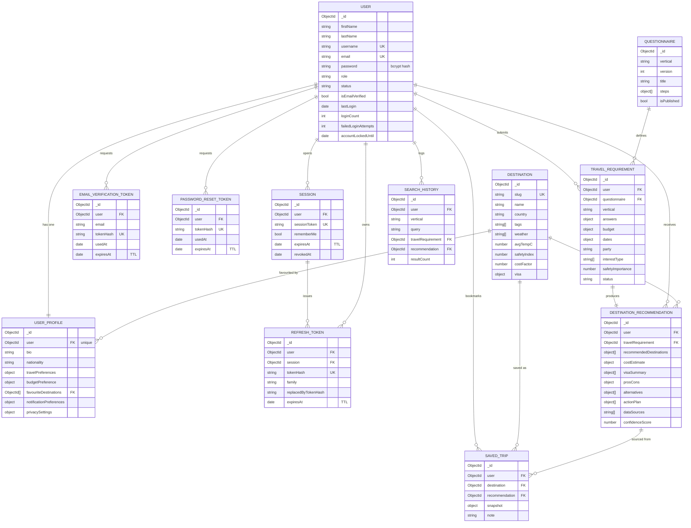
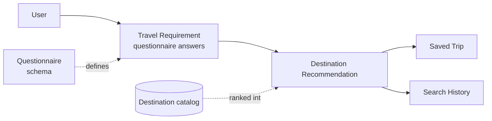

# Dorara — Entity Relationship Diagram

The Travel module database, with the shared authentication core. All
relationships are modeled with MongoDB `ObjectId` references (no embedded
cross-collection documents), keeping collections small and future modules
(Education, Healthcare, Jobs, Business) easy to add.

## Relationship overview

## Core decision chain

The heart of the product maps directly onto the frontend flow
(welcome → consult → results):

